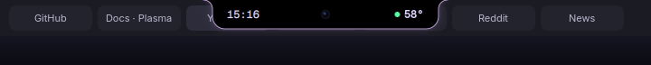
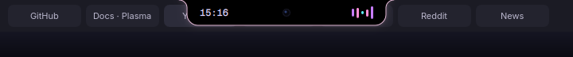
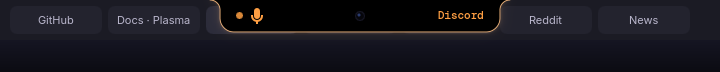
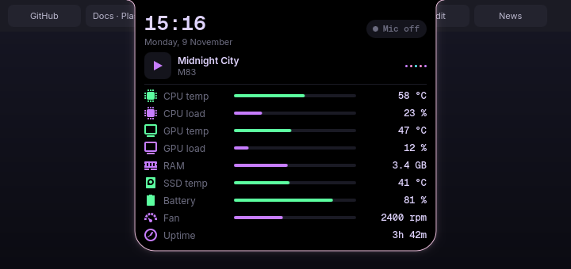

# Virtual Notch for KDE Plasma 6

A MacBook-style notch that sits at the top center of your screen on **KDE Plasma 6 (Wayland)**. It shows when your microphone is in use and what music is playing, and it opens a small card with temperatures and system stats.

It never gets in your way. Clicks go straight through it, and it **slides out of sight when your mouse comes near**, so browser tabs underneath stay visible and clickable.

| | |
|---|---|
| **Idle:** clock + CPU temperature |  |
| **Music playing:** live equalizer, pink rim |  |
| **Mic in use:** pulsing orange mic + app name |  |

**Stats card:** push your mouse to the top edge above the notch and hold it there.



> The screenshots are rendered from the widget's own QML with sample data (`tools/render-screenshots.sh`), so they match the real thing pixel for pixel.

## Features

- **Mic indicator.** The notch turns orange and shows which app is using your microphone (Discord, OBS, browsers, …). It reacts to PipeWire/PulseAudio events instead of polling.
- **Now playing.** An equalizer appears while music plays. The card also shows the track, artist and album art from any MPRIS player (Spotify, browsers, VLC, …).
- **Stats card.** CPU temperature and load, GPU temperature and load, RAM, SSD temperature, battery, fan speed and uptime. Sensors are detected automatically, and rows for sensors your machine lacks are hidden.
- **Out of your way.** Clicks pass through the notch, and it slides away when your mouse gets near.
- **Light on resources.** Sensors are only read while the card is open. Closed, it just checks CPU temperature every 5 s. There's no separate process: it runs inside `plasmashell`.
- **Survives sleep.** The notch re-attaches itself after suspend/resume or monitor changes.

## Requirements

- KDE Plasma **6.0 or newer**, on a **Wayland** session
- Qt **6.7 or newer**
- These Plasma components, which come with a normal Plasma install. Package names vary slightly by distro:

| Needed for | Component |
|---|---|
| overlay window | `layer-shell-qt` (its QML module) |
| sensors | `libksysguard` + `ksystemstats` |
| mic detection | `plasma-pa` |
| now playing | `plasma-workspace` |

The installer checks for these and tells you if anything is missing.

## Install

```bash
git clone https://github.com/wnibraj/plasma-virtual-notch.git
cd plasma-virtual-notch
./install.sh
```

The installer:

- installs for your user only, with no `sudo`
- installs the widget and a tiny KWin helper script
- detects your GPU, battery, fan and SSD sensors
- adds the notch to your session

It's safe to run again. To **update**, run `git pull && ./install.sh`.

## How to use it

| You do | The notch does |
|---|---|
| Nothing | Sits at the top center showing the clock and CPU temperature (or the equalizer while music plays) |
| Move the mouse close to it | Slides up out of the way, so you can see and click what's underneath |
| Push the mouse against the very top edge above it and hold for about ½ s | Expands into the stats card |
| Move the mouse off the card | Collapses back |
| An app starts using the mic | Turns orange, pulses, and shows the app's name |

## Uninstall

```bash
./uninstall.sh
```

This removes the widget, the KWin helper and their settings. Nothing else is touched.

## How it works

There are two small pieces:

1. **`package/`** is a Plasma widget. It lives invisibly (0 px wide) in one of your panels and opens its own click-through **layer-shell overlay** window, which holds the notch. Because the overlay ignores the mouse, it can never block clicks.
2. **`kwin-script/`** is a ~30-line KWin script that watches the cursor position. It tells the widget which zone the cursor is in (near the notch, at the top edge, or over the card), but only when that zone changes.

```
package/contents/ui/
  main.qml        state: mic detection, media, sensors, hover logic, overlay window
  Island.qml      the visuals: notch shape, rim/glow, collapsed + expanded layouts
  StatsCard.qml   the expanded card
  StatRow.qml     one row of the card
  Equalizer.qml   the animated music bars
kwin-script/contents/code/main.js   cursor-zone detector
tools/          offscreen screenshot renderer
```

## Customizing

- **Sensors.** If a stat is missing or wrong, list your sensor IDs:
  ```bash
  busctl --user call org.kde.ksystemstats1 /org/kde/ksystemstats1 org.kde.ksystemstats1 allSensors | grep -oE '"(gpu|power|lmsensors)/[^"]+"'
  ```
  Then set `gpuSensor`, `batterySensor`, `fanSensor` or `ssdSensor` in the widget's config, or just re-run `./install.sh`.
- **Colors and size.** These are the `c*` properties and `notchW`, `notchH` and `cardW` near the top of `package/contents/ui/main.qml`. If you change the size, update `NOTCH_W`, `NOTCH_H`, `CARD_W` and `CARD_H` in `kwin-script/contents/code/main.js` to match. Run `./install.sh` afterwards.
- **Apps ignored by the mic indicator.** Edit `ignoreRe` in `main.qml`. It already ignores EasyEffects, cava, pavucontrol and similar tools.

## Troubleshooting

- **The notch doesn't appear.** Make sure you're on a Wayland session (`echo $XDG_SESSION_TYPE`). Then restart Plasma with `systemctl --user restart plasma-plasmashell` and check for errors with `journalctl --user -b | grep -i virtualnotch`.
- **The notch doesn't move away or the card won't open.** Check that the KWin helper is enabled under *System Settings → Window Management → KWin Scripts → Virtual Notch hover*.
- **"Your widgets are locked".** Right-click the desktop, choose *Unlock Widgets*, and re-run the installer.

**Known limitation:** the notch is designed for a single screen and appears on the primary display.

## License

GPL-2.0-or-later. See [LICENSE](LICENSE).
